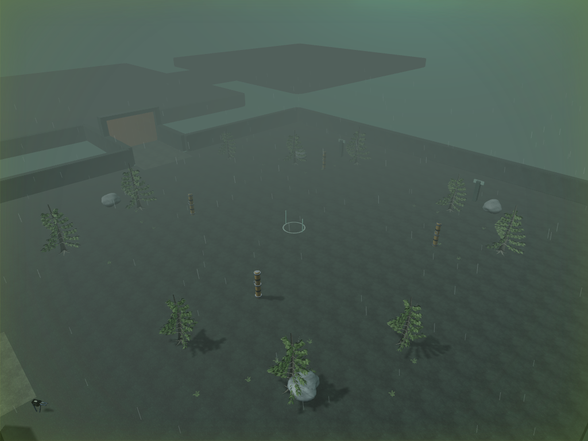
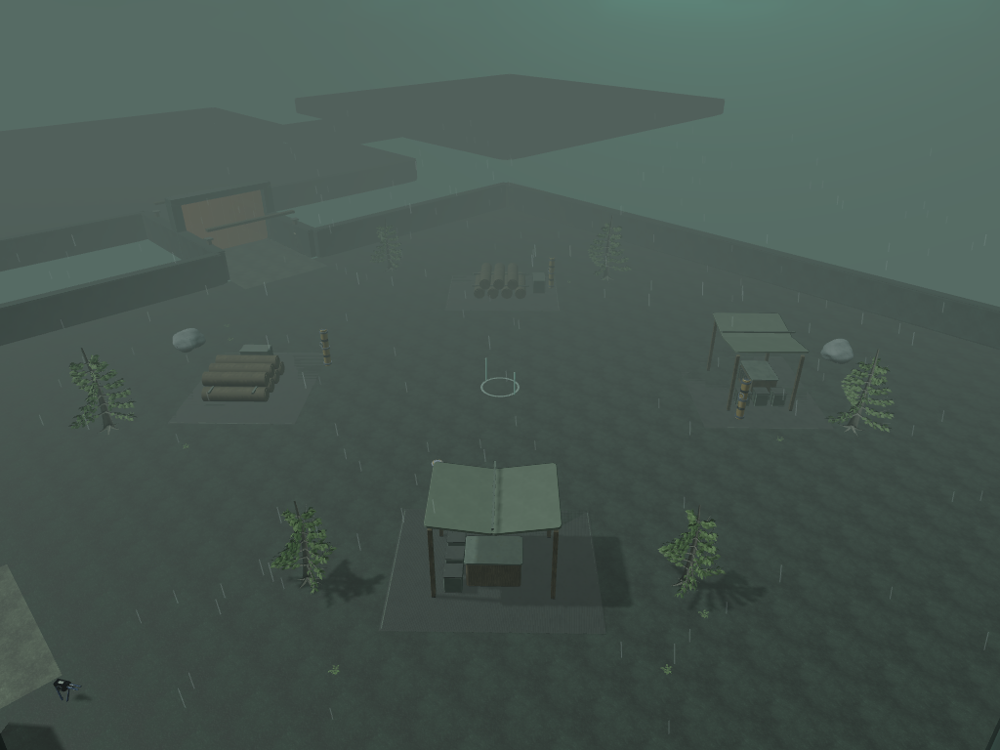
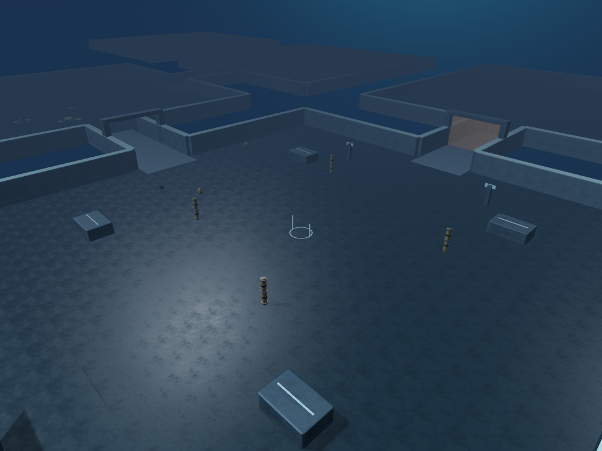
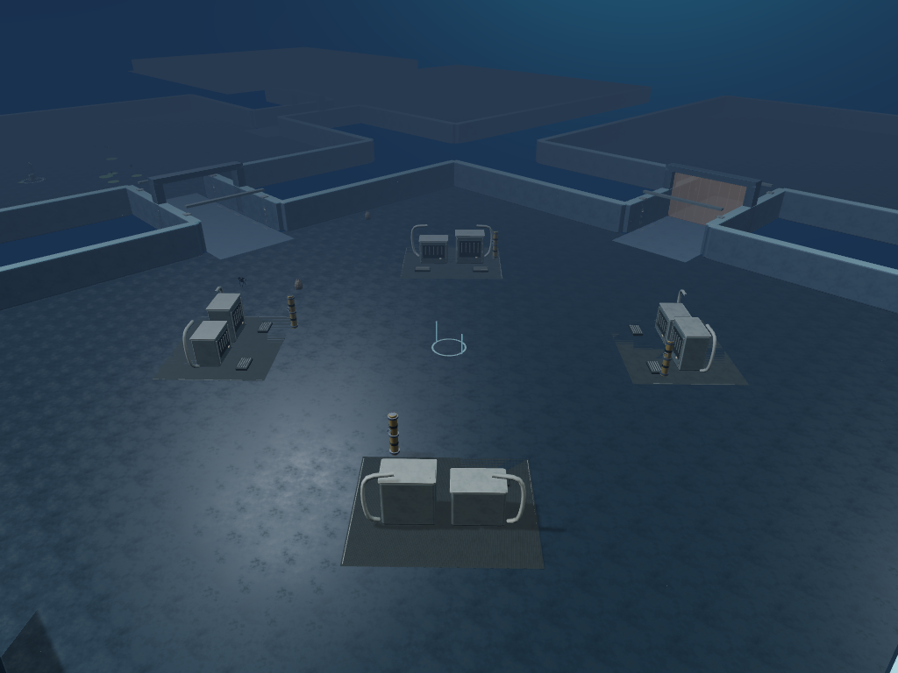
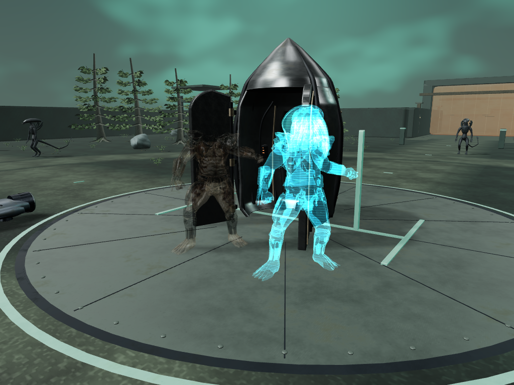
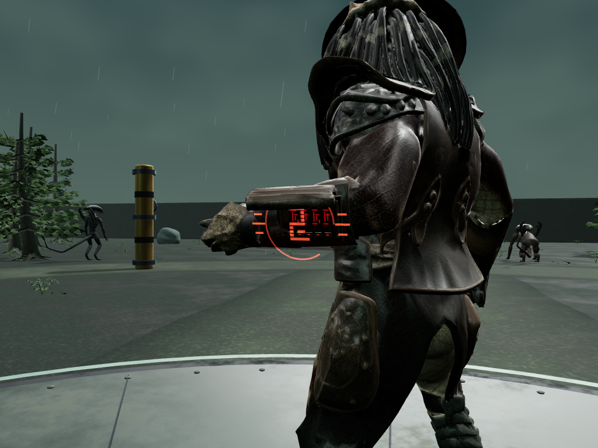

# Reprise du 25 octobre — scènes et effets validés

Cette passe utilise les modèles et matériaux réels du jeu. Les vues sont contrôlées automatiquement ; elles ne constituent pas un playtest humain ou une attestation de fidélité 1:1. Le build final porte l'empreinte `8683a627…`. Le [rapport complet](../development-validation.json) distingue les tests, les versions intermédiaires et la publication.

## Territoires plus lisibles

Les cinq territoires après l'insertion reçoivent quatre ensembles centraux, avec des variantes par lieu et par rôle. Les voies principales, les objectifs et les sas gardent leur fonctionnement. Les anciennes couvertures libèrent les nouvelles emprises.

| Vue large contrôlée | Avant | Après |
| --- | --- | --- |
| Atelier forestier |  |  |
| Station |  |  |

Plans rapprochés : [rondins visibles](after-forest-foundry-close.png), [bancs de machines](after-romulus_station-foundry-close.png), [ruche](after-xenomorph_prime-foundry-close.png), [temple](after-antarctic_pyramid-foundry-close.png). Les [rapports de cadrage](after-report.json) conservent les caméras et les parcours.

## Projection du véritable personnage

L'ancien leurre de deux primitives est remplacé par une silhouette complète, avec corps, masque et équipement. La pose est capturée au déploiement ; les lignes de scan utilisent le temps de simulation. Les buffers, matériaux et squelettes sont privés et survivent au remplacement de l'émetteur.

[Ancien leurre](before-city-holographic-decoy.png) · [Jungle Hunter](detailed-jungle_hunter-projection-fps-cloak.png) · [Wolf](detailed-wolf_predator-projection-fps-cloak.png) · [Deux projections indépendantes](two-hunter-private-projections.png)

## Effets sur les vraies articulations

Le compte à rebours suit le plan mesuré de la console City Hunter, pendant six secondes de simulation. L'expiration et le camouflage sont contrôlés dans la boucle réelle, y compris lorsque le joueur tombe en coopération.

Le trophée utilise la main importée et une silhouette correspondant à sa famille de victime. Ses ressources sont libérées à l'expiration, au remplacement ou à la fin de mission. L'exécution du boss enregistre désormais sa mort avant de terminer l'objectif.

[Prise en main](queen-trophy-held-at-imported-hand.png) · [Géométrie royale isolée pour contrôle](queen-trophy-isolated-private-geometry.png) · [Camouflage après compilation GPU](queen-trophy-after-gpu-cloak.png)

Le [relevé runtime](runtime-final-report.json) conserve les ancrages, ressources privées, temporisations, états de coopération et erreurs. Les budgets de décor sont des plafonds de scène contrôlés, sans garantie de fréquence d'images sur le matériel du joueur. Les toitures restent décoratives et la projection capture une pose fixe ; aucun nouveau scan de film ou crédit Meshy n'est utilisé.
