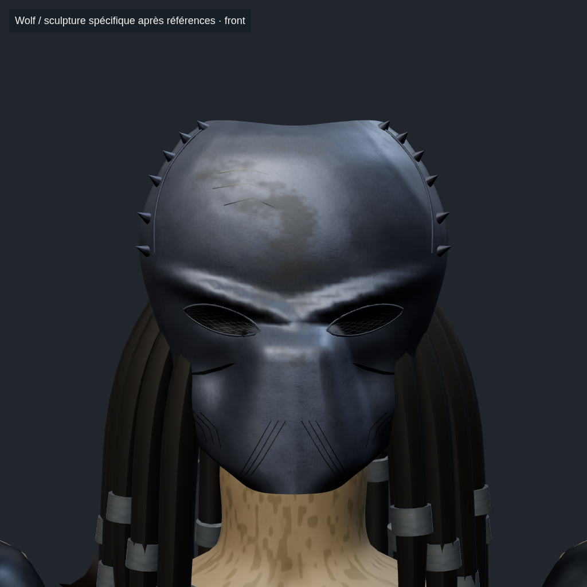
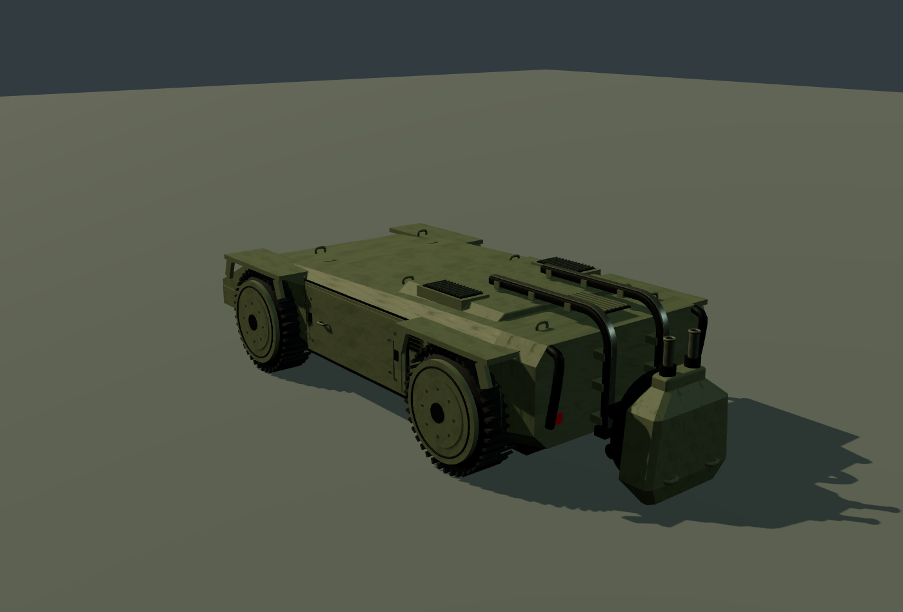

# Fidélité : formes et articulations — 25 octobre 2026

Le build final `cb19eded36c19e20a5c50b94daad56d1d8550cf1c9ddff08df6d0167d7a03910` intègre cette passe. Le [rapport de validation](../fidelity-validation.json) précise les tests, la version publiée et les limites. Les comparaisons de studio utilisent les vrais GLB et matériaux, avec caméra et lumière fixes ; elles ne mesurent pas les performances d'un ordinateur de jeu.

Les 26 captures de production du candidat `397cdbf1…` restent une preuve des mêmes géométries et matériaux. Ce candidat n'a pas été publié : une dernière vérification a montré qu'un ennemi trop proche et sous la butée de l'APC empêchait de tirer sur un autre ennemi atteignable. Le build final corrige uniquement cette sélection de cible, puis repasse les contrôles CPU, navigateur et ciblage réel. Les rapports des deux builds restent distincts.

## City Hunter : armure et extrémités de mèches

Le boîtier droit conserve ses trois surfaces natives, devenues rigides sur l'avant-bras. La comparaison plie le véritable os de main ; les UV, normales, tangentes et la pose de repos restent conservés. **Les lames restent fusionnées** : la coupe diagnostique avait des bords ouverts et n'a pas été activée.

[Poignet avant](gauntlet-before.png) · [Boîtier corrigé pendant la flexion](gauntlet-after.png) · [Mesures et coupe rejetée](../../meshy/NATIVE-WRISTBLADE-REVIEW.md)

La chevelure conserve les deux chaînes existantes et ajoute dix extrémités libres identifiées dans le vrai maillage : quarante os, 2 303 sommets pondérés et 887 sommets de colliers intacts. Le mouvement est local et modéré ; les gros faisceaux soudés restent fixes. Il ne s'agit pas de douze mèches complètes séparées.

[Chevelure avant](mane-before.png) · [Extrémités en mouvement](mane-motion.png) · [Calibration](../../meshy/CITY-HUNTER-MEASURED-MANE.md)

Le pilote sur serveur de développement a conservé quatre messages HMR causés par le blocage volontaire du rechargement pendant les éditions parallèles. Il ne constitue pas un contrôle entièrement vert. Le contrôle final utilise le build de production figé, sans HMR.

## Big Chap : chevilles et orteils

Quatre articulations mesurées s'ajoutent aux neuf os de queue. Les rotations des vrais clips font fléchir le pied sans déplacer les colliers du mollet ni les coutures UV. Les supports compacts reproduisent le minimum des 8 138 sommets concernés dans les 66 poses marche/course testées ; la garde au sol est de 0,005 unité. Les phases réellement aériennes sont conservées.

[Pose avant](ankle-before.png) · [Même pose articulée](ankle-after.png) · [Gros plan pied gauche](foot-left.png) · [Gros plan pied droit](foot-right.png) · [Méthode et limites](../../BIG-CHAP-ANKLES.md)

La forme des pieds et griffes reste très simplifiée dans la génération source. Cette passe n'ajoute pas de nouvelle anatomie, d'IK de pied planté, de correction du glissement horizontal ou de suivi des pentes.

## Wolf : masque propre à la variante

Quatre photographies officielles Prime 1 guident la couronne, les douze goujons, l'arcade en V, les lentilles opaques maillées, les joues creuses et le museau trapézoïdal. Une seconde revue a réduit et abaissé les yeux, compacté le museau et corrigé le métal trop poli. Le personnage conserve 47 maillages pour 169 560 triangles.

[Ancien masque](wolf-before.png) · [Masque corrigé](wolf-after.png) · [Profil](wolf-profile.png) · [Photographies et relevé](../../WOLF-BIOMASK.md)

La couronne demeure assez verticale, le museau large et lisse et les micro-piqûres atténuées par rapport aux photos. Le corps et les racines de chevelure restent procéduraux. Ce masque constitue une amélioration guidée par références, sans certification de fidélité 1:1.

## M577 : rangement réel derrière la caisse

Le chariot remonte depuis l'arrière bas, tourne au coin et rejoint le toit en 2,2 secondes. Les rails biseautés et les roulettes restent lisibles. Tout le carénage suit l'élévation des deux canons ; les collisions suivent les volumes mobiles, y compris le torse d'un acteur debout derrière le véhicule. Le flanc technique remplace la seconde porte symétrique.

[Affût rangé](../apc-mechanisms/apc-rear-stowed.png) · [Remontée](../apc-mechanisms/apc-rear-rising.png) · [Passage du coin](../apc-mechanisms/apc-rear-corner.png) · [Affût déployé](../apc-mechanisms/apc-rear-deployed.png) · [Flanc technique](../apc-mechanisms/apc-service-flank.png) · [Références et mesures](../../APC.md)

Les photos NECA montrent les détails et le retour du rail, mais pas toutes les positions ni leurs dimensions. Le rayon, les pivots et les cotes du rangement sont reconstruits localement. Suspension, intérieur habitable et véritable embarquement dans le Cheyenne restent ouverts.

## Portée de la validation

Les contrôles couvrent cinq axes : formes et surfaces ; transitions et jouabilité ; contacts et navigation ; ressources et budget ; provenance, propriété et nettoyage. Ce sont des tests automatisés et des revues d'agents IA, avec **zéro testeur humain déclaré**. Les douze GLB source gardent leurs empreintes et aucun crédit Meshy supplémentaire n'est dépensé.

L'[audit des chantiers](../../MODEL-FIDELITY-AUDIT.md) conserve les écarts restant à traiter, dont les lames natives, les anatomies simplifiées et les cinq autres corps Yautja non générés dans le budget City approuvé.
