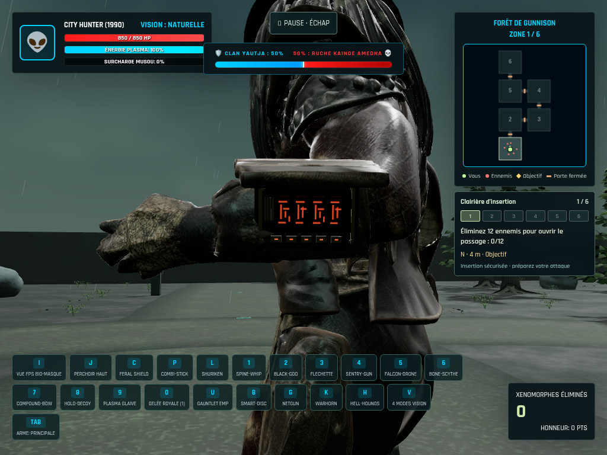
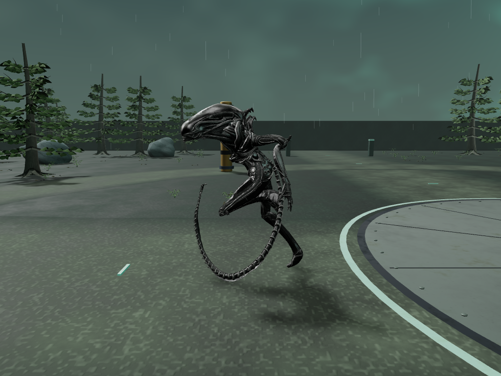
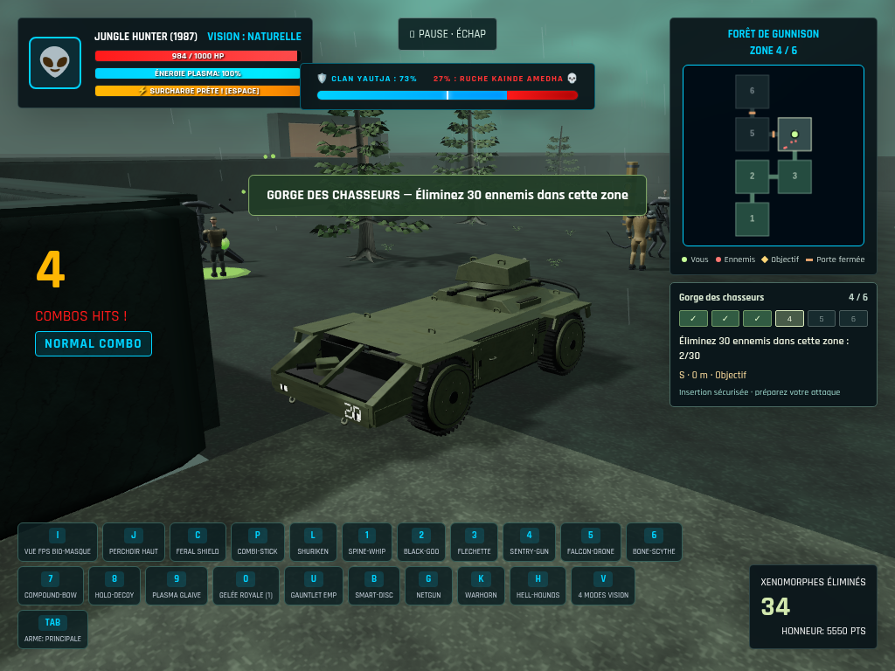

# Reprise du 24 octobre — captures du build local validé

Ces vues utilisent les vrais modèles et matériaux de l'application, dans des cadrages contrôlés. Elles ne constituent pas un playtest humain ou une attestation de fidélité 1:1. Le build d'index `9fdd1916…` est validé localement ; sa publication est bloquée par le quota quotidien Vercel. Voir le [rapport complet](../open-work-validation.json).

## Console City Hunter

La plaque d'origine s'ouvre sur un écran et des touches locaux. La peau reste intacte et le repos retrouve exactement la surface originale dans le cadrage de comparaison.

[Plaque fermée](city-console-closed-back.png) · [EMP](city-console-emp.png) · [Deux acteurs indépendants](city-coop-private-animation.png)

## Big Chap

Neuf os animent la queue. Les appuis sont mesurés sur les 8 138 sommets des régions mollets/pieds ; la compensation reste visuelle et ne crée pas d'IK des chevilles. À la même phase avec appuis, le minimum de queue passe de −0,1599 à +0,0221 unité du jeu, sans changer le corps entre les deux vues.

[Ancienne queue rigide, même phase](big-chap-run-rigid-reference.png) · [Mouvement à l'arrêt](big-chap-idle-tail-motion.png) · [Phase aérienne source conservée](big-chap-airborne-source-motion.png)

## APC et progression

Le véhicule rejoint le quatrième territoire. Les collisions ont été exercées avec le vrai joueur et un vrai ennemi ; le nettoyage retire aussi son obstacle de navigation.

Le relais passe de [l'attente](relay-awaiting-activation.png) à la [contre-attaque](relay-counterattack.png), puis à une [défense partielle avec sas fermé](relay-partially-defended.png) et au [secteur sécurisé](relay-secured.png). Les renforts et les éliminations suivent les mécanismes réels du jeu.

Le [relevé runtime](runtime-final-report.json) conserve les poses, les appuis, la caméra à 10/30/60/120 images par seconde, les erreurs réseau et le nettoyage. Les 19 captures et les rapports sont issus de contrôles automatisés, sans garantie de fréquence d'images sur matériel de jeu.
